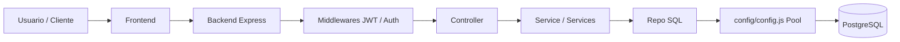
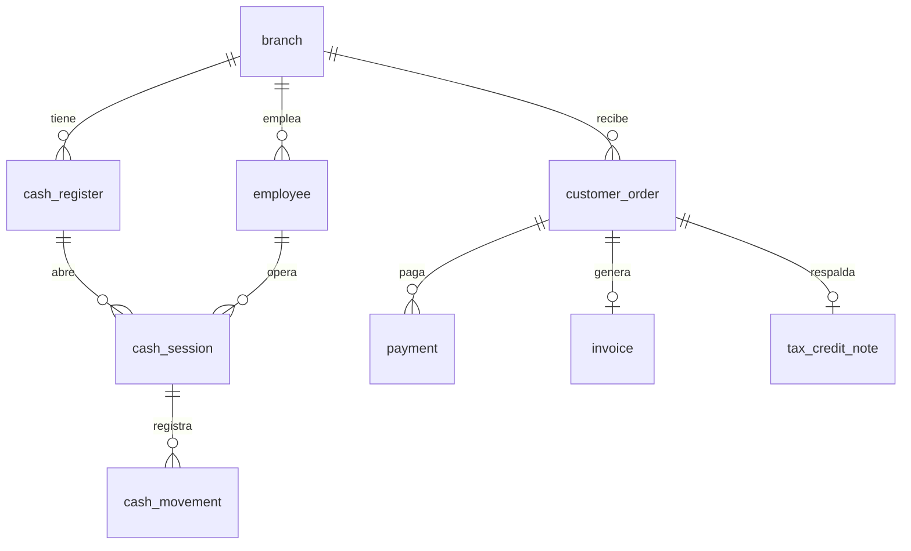

# Documentación técnica: ERP y POS — Cafetería y Comida Típica

| Campo | Valor |
|---|---|
| Versión del documento | 1.0.0 |
| Fecha | 26/11/2026 |
| Autores | 1. Merlyn Rosemary Campos Merlos 00020725<br>2. Axel Alessandro Rivas Moran 00153925<br>3. Reynaldo Alexander Avelar Linares 00125625<br>4. Diana Abigail Castillo Ramos 00036625<br>5. Leandro Javier Aquino Merino 00036725<br>6. Carlos Daniel Martínez Rojas 00252125<br>7. Jaqueline Nicole Cardoza Maldonado 00252125 |
| Repositorio | https://github.com/LJAquino25/proyecto-web-ejercicio1.git |


## 1. Descripción general

Aplicación web de gestión operativa y punto de venta (POS/ERP) diseñada para sucursales de cafetería y comida típica (con contexto de operación multi-sucursal, facturación normal y crédito fiscal con 13% de IVA, y pagos en efectivo, tarjeta y billeteras/medios digitales). Centraliza ventas, turnos de caja, inventario/recetas, compras, planilla y acceso de usuarios para reducir errores manuales y desorden operativo entre áreas.

### 1.1 Alcance

**Incluye:**
- Gestión de sucursales, empleados, clientes y autenticación/autorización.
- Gestión de caja y turnos (apertura, movimientos/ventas, cierre y cuadre).
- Catálogo de productos (preparados y empaquetados), insumos, recetas e inventario por sucursal.
- Compras, cuentas por pagar y pagos a proveedores.
- Pedidos, pagos y facturación (comprobante normal y crédito fiscal).

**No incluye:**
-  app móvil nativa y pasarela en producción real

### 1.2 Funcionalidades principales

| Módulo | Descripción | Rol que lo usa |
|---|---|---|
| Autenticación y registro (`login-register`) | Inicio de sesión, registro y control de acceso mediante middlewares JWT y autorización | Todos / Admin / Cajero |
| Caja y turnos (`cash-register`) | Apertura de caja, registro de ventas/movimientos, cierre y cálculo de cuadre | Cajero / Admin |
| RR. HH. y planilla (`hr-payroll`) | Gestión de empleados y cálculo de planilla quincenal con deducciones | Admin / RR. HH. |
| Inventario y recetas (`inventory-recipes`) | Productos, insumos, recetas, stock por sucursal y movimientos de inventario | Admin / Cocina / Bodega |
| Compras y gastos (`purchases-expenses`) | Registro de compras, cuentas por pagar y pagos a proveedores | Admin / Compras |
| Ventas y facturación (`sales-billing`) | Pedidos, pagos, facturas normales y notas de crédito fiscal | Cajero / Ventas / Admin |

---

## 2. Stack tecnológico

| Capa | Tecnología | Versión | Para qué se usa |
|---|---|---|---|
| Frontend | [React / framework web] | 1.0.0 | [Interfaz de usuario] |
| Backend | Node.js + Express (CommonJS) | 1.0.0 | API REST y lógica de negocio |
| Base de datos | PostgreSQL (`pg`, `dotenv`) | 1.0.0 | Persistencia relacional de datos |
| Control de versiones | Git + GitHub | 1.0.0 | Código fuente y trabajo colaborativo |

---

## 3. Arquitectura

### 3.1 Diagrama general



### 3.2 Descripción de componentes

- **Frontend:** Interfaz cliente que consume los endpoints del backend (en desarrollo/integración).
- **Backend:** API en Node.js y Express organizada en capas (`routes` → `middleware` → `controller` → `service/services` → `repo`), usando `config/config.js` para conectarse a PostgreSQL.
- **Base de datos:** PostgreSQL con scripts estructurales en dos idiomas (`src/db/BD_ingles.sql` y `src/db/BD_español.sql`) y datos iniciales en `src/db/BD_poblado.sql`.


### 3.3 Estructura de carpetas

```text
backend/
├── src/
│   ├── config/
│   │   └── config.js
│   ├── db/
│   │   ├── BD_ingles.sql
│   │   ├── BD_español.sql
│   │   └── BD_poblado.sql
│   ├── middleware/
│   │   ├── authorization.middleware.js
│   │   └── jwt.middleware.js
│   ├── modules/
│   │   ├── cash-register/
│   │   ├── hr-payroll/
│   │   ├── inventory-recipes/
│   │   ├── login-register/
│   │   ├── purchases-expenses/
│   │   └── sales-billing/
│   ├── routes/
│   │   ├── modules/
│   │   └── index.js
│   └── app.js
├── .env.example
├── package.json
└── package-lock.json
```

---

## 4. Instalación y puesta en marcha

### 4.1 Requisitos previos

- Node.js (versión recomendada del proyecto)
- PostgreSQL (y cliente SQL como DBeaver o `psql`)
- Git

### 4.2 Pasos

```bash
# 1. Clonar el repositorio y entrar a backend
git clone [URL_DEL_REPOSITORIO]
cd [carpeta-del-proyecto]/backend

# 2. Instalar dependencias
npm install

# 3. Crear archivo de entorno a partir del ejemplo
cp .env.example .env

# 4. Crear la BD en PostgreSQL y ejecutar el script elegido + poblado
# (Verificar cuál script de estructura se usará: BD_ingles.sql o BD_español.sql)

# 5. Arrancar el servidor en desarrollo
npm run dev
```

La API quedará disponible en `http://localhost:[puerto_configurado]` (por ejemplo `http://localhost:3005`).

### 4.3 Variables de entorno

| Variable | Descripción | Ejemplo |
|---|---|---|
| `PORT` | Puerto en el que escucha el servidor Express | `3005` |
| `DB_HOST` | Host del servidor PostgreSQL | `localhost` |
| `DB_PORT` | Puerto de PostgreSQL | `5432` |
| `DB_NAME` | Nombre de la base de datos | `nombre_bd` |
| `DB_USER` | Usuario de PostgreSQL | `postgres` |
| `DB_PASSWORD` | Contraseña del usuario de PostgreSQL | `[clave_local]` |
| `[JWT_SECRET]` | Clave secreta para firmar tokens si aplica en el entorno | `[cadena_segura]` |

### 4.4 Comandos útiles

| Comando | Qué hace |
|---|---|
| `npm run dev` | Inicia el servidor backend en modo desarrollo |
| `[npm start]` | Inicia el servidor según lo definido en `package.json` |
| `[npm test]` | Ejecuta pruebas si están configuradas |

---

## 5. Base de datos

> **Nota sobre idiomas:** Existen scripts de esquema en dos idiomas (`BD_ingles.sql` y `BD_español.sql`) junto con `BD_poblado.sql`. Verifica cuál archivo estructura la base de datos activa antes de ejecutar consultas o pruebas.

### 5.1 Diagrama entidad-relación



### 5.2 Descripción de tablas

| Tabla | Campo | Tipo | Descripción |
|---|---|---|---|
| `branch` | `id` | `SERIAL` (PK) | Identificador de la sucursal |
| `branch` | `name` | `VARCHAR` (UNIQUE) | Nombre único de la sucursal |
| `employee` | `id` | `SERIAL` (PK) | Identificador del empleado |
| `employee` | `branch_id` | `INT` (FK) | Sucursal asignada (`branch.id`) |
| `payroll` | `id` | `SERIAL` (PK) | Registro de planilla quincenal |
| `product` | `id` | `SERIAL` (PK) | Catálogo general de productos |
| `supply` | `id` | `SERIAL` (PK) | Catálogo de insumos |
| `purchase` | `id` | `SERIAL` (PK) | Cabecera de compra a proveedor |
| `cash_register` | `id` | `SERIAL` (PK) | Caja registrada en una sucursal |
| `cash_session` | `id` | `SERIAL` (PK) | Turno/sesión de caja (apertura, montos y cierre) |
| `cash_movement` | `id` | `SERIAL` (PK) | Movimientos de entrada/salida de efectivo en el turno |
| `customer_order` | `id` | `SERIAL` (PK) | Pedido o venta de cliente |
| `payment` | `id` | `SERIAL` (PK) | Pago asociado a un pedido y sesión de caja |
| `invoice` | `correlative` | `SERIAL` (PK) | Correlativo de factura emitida |
| `tax_credit_note` | `order_id` | `INT` (PK/FK) | Datos fiscales para crédito fiscal (`nit`, `nrc`, etc.) |

---

## 6. Documentación de la API

> **Nota:** Los prefijos base montados en `src/routes/index.js` y los nombres de campos en `body`/`query`/`params` pueden variar según el montaje y el idioma del esquema SQL activo (`BD_ingles.sql` o `BD_español.sql`). Verifica `src/routes/index.js` y cada controlador antes de ejecutar pruebas. 
### 6.1 Caja y turnos (`cash-register`)

#### `POST /open`
**Descripción:** Abre un turno de caja. Requiere `requireEmployee`.

**Cuerpo de la petición:**
```json
{
  "campo": "valor"
}
```

**Respuesta exitosa (200 / 201):**
```json
{
  "ok": true,
  "data": {}
}
```

**Errores posibles:**

| Código | Motivo |
|---|---|
| 400 | Datos inválidos o incompletos |
| 401 / 403 | No autenticado o sin permiso de empleado (`requireEmployee`) |
| 409 | Conflicto por turno ya abierto o regla de negocio |
| 500 | Error interno del servidor |

**Ejemplo con curl:**
```bash
curl -X POST http://localhost:[puerto]/api/[modulo]/open \
  -H "Content-Type: application/json" \
  -d '{"campo":"valor"}'
```

#### `POST /close`
**Descripción:** Cierra un turno de caja y calcula el cuadre. Requiere `requireEmployee`.

**Cuerpo de la petición:**
```json
{
  "campo": "valor"
}
```

**Respuesta exitosa (200):**
```json
{
  "ok": true,
  "data": {}
}
```

**Errores posibles:**

| Código | Motivo |
|---|---|
| 400 | Datos inválidos o incompletos |
| 401 / 403 | No autenticado o sin permiso de empleado (`requireEmployee`) |
| 404 | Turno o recurso no encontrado |
| 409 | Turno ya cerrado o estado inválido |
| 500 | Error interno del servidor |

**Ejemplo con curl:**
```bash
curl -X POST http://localhost:[puerto]/api/[modulo]/close \
  -H "Content-Type: application/json" \
  -d '{"campo":"valor"}'
```

#### `GET /history`
**Descripción:** Consulta el historial de turnos/sesiones de caja.

**Cuerpo de la petición:**
```json
{}
```

**Respuesta exitosa (200):**
```json
{
  "ok": true,
  "data": []
}
```

**Errores posibles:**

| Código | Motivo |
|---|---|
| 400 | Parámetros de consulta inválidos |
| 500 | Error interno del servidor |

**Ejemplo con curl:**
```bash
curl -X GET "http://localhost:[puerto]/api/[modulo]/history"
```

#### `POST /sale`
**Descripción:** Registra una venta/movimiento de venta en el turno abierto.

**Cuerpo de la petición:**
```json
{
  "campo": "valor"
}
```

**Respuesta exitosa (200 / 201):**
```json
{
  "ok": true,
  "data": {}
}
```

**Errores posibles:**

| Código | Motivo |
|---|---|
| 400 | Datos inválidos o incompletos |
| 404 / 409 | No existe turno abierto o conflicto de estado |
| 500 | Error interno del servidor |

**Ejemplo con curl:**
```bash
curl -X POST http://localhost:[puerto]/api/[modulo]/sale \
  -H "Content-Type: application/json" \
  -d '{"campo":"valor"}'
```

---

### 6.2 RR. HH. y planilla (`hr-payroll`)

#### `POST /employee`
**Descripción:** Crea un registro de empleado. Requiere `requireAdmin`.

**Cuerpo de la petición:**
```json
{
  "campo": "valor"
}
```

**Respuesta exitosa (201):**
```json
{
  "ok": true,
  "data": {}
}
```

**Errores posibles:**

| Código | Motivo |
|---|---|
| 400 | Datos inválidos o incompletos |
| 401 / 403 | No autenticado o sin permiso de administrador (`requireAdmin`) |
| 409 | Registro duplicado o restricción de base de datos |
| 500 | Error interno del servidor |

**Ejemplo con curl:**
```bash
curl -X POST http://localhost:[puerto]/api/[modulo]/employee \
  -H "Content-Type: application/json" \
  -d '{"campo":"valor"}'
```

#### `GET /employee`
**Descripción:** Lista empleados.

**Cuerpo de la petición:**
```json
{}
```

**Respuesta exitosa (200):**
```json
{
  "ok": true,
  "data": []
}
```

**Errores posibles:**

| Código | Motivo |
|---|---|
| 400 | Parámetros inválidos |
| 500 | Error interno del servidor |

**Ejemplo con curl:**
```bash
curl -X GET "http://localhost:[puerto]/api/[modulo]/employee"
```

#### `PUT /employee`
**Descripción:** Edita un empleado existente. Requiere `requireAdmin`.

**Cuerpo de la petición:**
```json
{
  "campo": "valor"
}
```

**Respuesta exitosa (200):**
```json
{
  "ok": true,
  "data": {}
}
```

**Errores posibles:**

| Código | Motivo |
|---|---|
| 400 | Datos inválidos o incompletos |
| 401 / 403 | No autenticado o sin permiso de administrador (`requireAdmin`) |
| 404 | Empleado no encontrado |
| 500 | Error interno del servidor |

**Ejemplo con curl:**
```bash
curl -X PUT http://localhost:[puerto]/api/[modulo]/employee \
  -H "Content-Type: application/json" \
  -d '{"campo":"valor"}'
```

#### `DELETE /employee`
**Descripción:** Elimina un empleado. Requiere `requireAdmin`.

**Cuerpo de la petición:**
```json
{
  "campo": "valor"
}
```

**Respuesta exitosa (200):**
```json
{
  "ok": true,
  "data": {}
}
```

**Errores posibles:**

| Código | Motivo |
|---|---|
| 400 | Parámetro o identificador inválido |
| 401 / 403 | No autenticado o sin permiso de administrador (`requireAdmin`) |
| 404 / 409 | Empleado no encontrado o referenciado por otros registros |
| 500 | Error interno del servidor |

**Ejemplo con curl:**
```bash
curl -X DELETE http://localhost:[puerto]/api/[modulo]/employee \
  -H "Content-Type: application/json" \
  -d '{"campo":"valor"}'
```

#### `POST /payroll`
**Descripción:** Genera o registra una planilla. Requiere `requireAdmin`.

**Cuerpo de la petición:**
```json
{
  "campo": "valor"
}
```

**Respuesta exitosa (201):**
```json
{
  "ok": true,
  "data": {}
}
```

**Errores posibles:**

| Código | Motivo |
|---|---|
| 400 | Datos inválidos o incompletos |
| 401 / 403 | No autenticado o sin permiso de administrador (`requireAdmin`) |
| 409 | Planilla duplicada para el período/quincena o conflicto |
| 500 | Error interno del servidor |

**Ejemplo con curl:**
```bash
curl -X POST http://localhost:[puerto]/api/[modulo]/payroll \
  -H "Content-Type: application/json" \
  -d '{"campo":"valor"}'
```

#### `GET /payroll`
**Descripción:** Consulta el listado de planillas. Requiere `requireAdmin`.

**Cuerpo de la petición:**
```json
{}
```

**Respuesta exitosa (200):**
```json
{
  "ok": true,
  "data": []
}
```

**Errores posibles:**

| Código | Motivo |
|---|---|
| 400 | Parámetros inválidos |
| 401 / 403 | No autenticado o sin permiso de administrador (`requireAdmin`) |
| 500 | Error interno del servidor |

**Ejemplo con curl:**
```bash
curl -X GET "http://localhost:[puerto]/api/[modulo]/payroll"
```

---

### 6.3 Inventario y recetas (`inventory-recipes`)

#### `POST /products`
**Descripción:** Registra productos en el módulo de inventario/catálogo.

**Cuerpo de la petición:**
```json
{
  "campo": "valor"
}
```

**Respuesta exitosa (201):**
```json
{
  "ok": true,
  "data": {}
}
```

**Errores posibles:**

| Código | Motivo |
|---|---|
| 400 | Datos inválidos o incompletos |
| 500 | Error interno del servidor |

**Ejemplo con curl:**
```bash
curl -X POST http://localhost:[puerto]/api/[modulo]/products \
  -H "Content-Type: application/json" \
  -d '{"campo":"valor"}'
```

#### `GET /products`
**Descripción:** Lista los productos registrados.

**Cuerpo de la petición:**
```json
{}
```

**Respuesta exitosa (200):**
```json
{
  "ok": true,
  "data": []
}
```

**Errores posibles:**

| Código | Motivo |
|---|---|
| 400 | Parámetros inválidos |
| 500 | Error interno del servidor |

**Ejemplo con curl:**
```bash
curl -X GET "http://localhost:[puerto]/api/[modulo]/products"
```

#### `POST /recipes`
**Descripción:** Registra una receta y sus insumos asociados.

**Cuerpo de la petición:**
```json
{
  "campo": "valor"
}
```

**Respuesta exitosa (201):**
```json
{
  "ok": true,
  "data": {}
}
```

**Errores posibles:**

| Código | Motivo |
|---|---|
| 400 | Datos inválidos o incompletos |
| 404 | Producto o insumo inexistente |
| 500 | Error interno del servidor |

**Ejemplo con curl:**
```bash
curl -X POST http://localhost:[puerto]/api/[modulo]/recipes \
  -H "Content-Type: application/json" \
  -d '{"campo":"valor"}'
```

#### `GET /recipes`
**Descripción:** Lista las recetas disponibles.

**Cuerpo de la petición:**
```json
{}
```

**Respuesta exitosa (200):**
```json
{
  "ok": true,
  "data": []
}
```

**Errores posibles:**

| Código | Motivo |
|---|---|
| 400 | Parámetros inválidos |
| 500 | Error interno del servidor |

**Ejemplo con curl:**
```bash
curl -X GET "http://localhost:[puerto]/api/[modulo]/recipes"
```

#### `GET /catalog`
**Descripción:** Consulta el menú o catálogo disponible.

**Cuerpo de la petición:**
```json
{}
```

**Respuesta exitosa (200):**
```json
{
  "ok": true,
  "data": []
}
```

**Errores posibles:**

| Código | Motivo |
|---|---|
| 400 | Parámetros inválidos |
| 500 | Error interno del servidor |

**Ejemplo con curl:**
```bash
curl -X GET "http://localhost:[puerto]/api/[modulo]/catalog"
```

#### `GET /inventory/alerts`
**Descripción:** Obtiene alertas de stock bajo/mínimo en inventario.

**Cuerpo de la petición:**
```json
{}
```

**Respuesta exitosa (200):**
```json
{
  "ok": true,
  "data": []
}
```

**Errores posibles:**

| Código | Motivo |
|---|---|
| 400 | Parámetros inválidos |
| 500 | Error interno del servidor |

**Ejemplo con curl:**
```bash
curl -X GET "http://localhost:[puerto]/api/[modulo]/inventory/alerts"
```

#### `POST /prepare`
**Descripción:** Ejecuta la preparación de una receta descontando/actualizando inventario.

**Cuerpo de la petición:**
```json
{
  "campo": "valor"
}
```

**Respuesta exitosa (200 / 201):**
```json
{
  "ok": true,
  "data": {}
}
```

**Errores posibles:**

| Código | Motivo |
|---|---|
| 400 | Datos inválidos o stock insuficiente |
| 404 | Receta o inventario no encontrado |
| 500 | Error interno del servidor |

**Ejemplo con curl:**
```bash
curl -X POST http://localhost:[puerto]/api/[modulo]/prepare \
  -H "Content-Type: application/json" \
  -d '{"campo":"valor"}'
```

#### `POST /catalog`
**Descripción:** Agrega elementos al catálogo.

**Cuerpo de la petición:**
```json
{
  "campo": "valor"
}
```

**Respuesta exitosa (201):**
```json
{
  "ok": true,
  "data": {}
}
```

**Errores posibles:**

| Código | Motivo |
|---|---|
| 400 | Datos inválidos o incompletos |
| 500 | Error interno del servidor |

**Ejemplo con curl:**
```bash
curl -X POST http://localhost:[puerto]/api/[modulo]/catalog \
  -H "Content-Type: application/json" \
  -d '{"campo":"valor"}'
```

---

### 6.4 Autenticación y clientes (`login-register`)

#### `POST /customer`
**Descripción:** Registra un nuevo cliente.

**Cuerpo de la petición:**
```json
{
  "campo": "valor"
}
```

**Respuesta exitosa (201):**
```json
{
  "ok": true,
  "data": {}
}
```

**Errores posibles:**

| Código | Motivo |
|---|---|
| 400 | Datos inválidos o incompletos |
| 409 | Correo o registro ya existente |
| 500 | Error interno del servidor |

**Ejemplo con curl:**
```bash
curl -X POST http://localhost:[puerto]/api/[modulo]/customer \
  -H "Content-Type: application/json" \
  -d '{"campo":"valor"}'
```

#### `GET /customer`
**Descripción:** Lista clientes. Requiere `verifyToken`.

**Cuerpo de la petición:**
```json
{}
```

**Respuesta exitosa (200):**
```json
{
  "ok": true,
  "data": []
}
```

**Errores posibles:**

| Código | Motivo |
|---|---|
| 401 | Token faltante o inválido (`verifyToken`) |
| 500 | Error interno del servidor |

**Ejemplo con curl:**
```bash
curl -X GET "http://localhost:[puerto]/api/[modulo]/customer" \
  -H "Authorization: Bearer [TOKEN]"
```

#### `PUT /customer`
**Descripción:** Edita los datos de un cliente. Requiere `verifyToken` y `requireCustomer`.

**Cuerpo de la petición:**
```json
{
  "campo": "valor"
}
```

**Respuesta exitosa (200):**
```json
{
  "ok": true,
  "data": {}
}
```

**Errores posibles:**

| Código | Motivo |
|---|---|
| 400 | Datos inválidos o incompletos |
| 401 / 403 | Token inválido o sin rol de cliente (`verifyToken`, `requireCustomer`) |
| 404 | Cliente no encontrado |
| 500 | Error interno del servidor |

**Ejemplo con curl:**
```bash
curl -X PUT http://localhost:[puerto]/api/[modulo]/customer \
  -H "Authorization: Bearer [TOKEN]" \
  -H "Content-Type: application/json" \
  -d '{"campo":"valor"}'
```

#### `DELETE /customer`
**Descripción:** Elimina un cliente. Requiere `verifyToken` y `requireCustomer`.

**Cuerpo de la petición:**
```json
{
  "campo": "valor"
}
```

**Respuesta exitosa (200):**
```json
{
  "ok": true,
  "data": {}
}
```

**Errores posibles:**

| Código | Motivo |
|---|---|
| 400 | Identificador inválido |
| 401 / 403 | Token inválido o sin rol de cliente (`verifyToken`, `requireCustomer`) |
| 404 / 409 | Cliente no encontrado o asociado a pedidos |
| 500 | Error interno del servidor |

**Ejemplo con curl:**
```bash
curl -X DELETE http://localhost:[puerto]/api/[modulo]/customer \
  -H "Authorization: Bearer [TOKEN]"
```

#### `POST /login`
**Descripción:** Inicia sesión y devuelve credenciales/token según la implementación del controlador.

**Cuerpo de la petición:**
```json
{
  "campo": "valor"
}
```

**Respuesta exitosa (200):**
```json
{
  "ok": true,
  "data": {}
}
```

**Errores posibles:**

| Código | Motivo |
|---|---|
| 400 | Faltan credenciales o formato inválido |
| 401 | Credenciales incorrectas |
| 500 | Error interno del servidor |

**Ejemplo con curl:**
```bash
curl -X POST http://localhost:[puerto]/api/[modulo]/login \
  -H "Content-Type: application/json" \
  -d '{"campo":"valor"}'
```

#### `POST /logout`
**Descripción:** Cierra la sesión del usuario.

**Cuerpo de la petición:**
```json
{}
```

**Respuesta exitosa (200):**
```json
{
  "ok": true,
  "data": {}
}
```

**Errores posibles:**

| Código | Motivo |
|---|---|
| 400 / 401 | Petición o sesión inválida |
| 500 | Error interno del servidor |

**Ejemplo con curl:**
```bash
curl -X POST http://localhost:[puerto]/api/[modulo]/logout
```

---

### 6.5 Ventas y facturación (`sales-billing`)

#### `POST /orders`
**Descripción:** Crea un nuevo pedido.

**Cuerpo de la petición:**
```json
{
  "campo": "valor"
}
```

**Respuesta exitosa (201):**
```json
{
  "ok": true,
  "data": {}
}
```

**Errores posibles:**

| Código | Motivo |
|---|---|
| 400 | Datos inválidos o incompletos |
| 404 | Producto, sucursal o cliente inexistente |
| 500 | Error interno del servidor |

**Ejemplo con curl:**
```bash
curl -X POST http://localhost:[puerto]/api/[modulo]/orders \
  -H "Content-Type: application/json" \
  -d '{"campo":"valor"}'
```

#### `GET /orders`
**Descripción:** Consulta el listado de pedidos.

**Cuerpo de la petición:**
```json
{}
```

**Respuesta exitosa (200):**
```json
{
  "ok": true,
  "data": []
}
```

**Errores posibles:**

| Código | Motivo |
|---|---|
| 400 | Parámetros de consulta inválidos |
| 500 | Error interno del servidor |

**Ejemplo con curl:**
```bash
curl -X GET "http://localhost:[puerto]/api/[modulo]/orders"
```

#### `PUT /orders`
**Descripción:** Actualiza un pedido existente.

**Cuerpo de la petición:**
```json
{
  "campo": "valor"
}
```

**Respuesta exitosa (200):**
```json
{
  "ok": true,
  "data": {}
}
```

**Errores posibles:**

| Código | Motivo |
|---|---|
| 400 | Datos inválidos o transición de estado no permitida |
| 404 | Pedido no encontrado |
| 500 | Error interno del servidor |

**Ejemplo con curl:**
```bash
curl -X PUT http://localhost:[puerto]/api/[modulo]/orders \
  -H "Content-Type: application/json" \
  -d '{"campo":"valor"}'
```

#### `DELETE /orders`
**Descripción:** Elimina un pedido.

**Cuerpo de la petición:**
```json
{
  "campo": "valor"
}
```

**Respuesta exitosa (200):**
```json
{
  "ok": true,
  "data": {}
}
```

**Errores posibles:**

| Código | Motivo |
|---|---|
| 400 | Identificador inválido |
| 404 / 409 | Pedido no encontrado o ya facturado/pagado |
| 500 | Error interno del servidor |

**Ejemplo con curl:**
```bash
curl -X DELETE http://localhost:[puerto]/api/[modulo]/orders \
  -H "Content-Type: application/json" \
  -d '{"campo":"valor"}'
```

#### `POST /invoices`
**Descripción:** Emite o registra una factura/comprobante asociado a un pedido.

**Cuerpo de la petición:**
```json
{
  "campo": "valor"
}
```

**Respuesta exitosa (201):**
```json
{
  "ok": true,
  "data": {}
}
```

**Errores posibles:**

| Código | Motivo |
|---|---|
| 400 | Datos inválidos o pedido no apto para facturar |
| 404 / 409 | Pedido no encontrado o ya facturado |
| 500 | Error interno del servidor |

**Ejemplo con curl:**
```bash
curl -X POST http://localhost:[puerto]/api/[modulo]/invoices \
  -H "Content-Type: application/json" \
  -d '{"campo":"valor"}'
```

#### `GET /invoices`
**Descripción:** Obtiene el listado de facturas y notas de crédito fiscal. Requiere `requireEmployee`.

**Cuerpo de la petición:**
```json
{}
```

**Respuesta exitosa (200):**
```json
{
  "ok": true,
  "data": []
}
```

**Errores posibles:**

| Código | Motivo |
|---|---|
| 400 | Parámetros de consulta inválidos |
| 401 / 403 | No autenticado o sin permiso de empleado (`requireEmployee`) |
| 500 | Error interno del servidor |

**Ejemplo con curl:**
```bash
curl -X GET "http://localhost:[puerto]/api/[modulo]/invoices" \
  -H "Authorization: Bearer [TOKEN]"
```
### 6.6 Compras, Proveedores y Gastos Generales (`purchases-expenses`)

> **Prefijo base:** `/api/purchases` — Todas las rutas requieren autenticación mediante cookie `token` (`verifyToken`).

#### `POST /supplier`
**Descripción:** Registra un nuevo proveedor en el catálogo.

**Cuerpo de la petición:**
```json
{
  "name": "Distribuidora El Sol",
  "phone": "2255-8899"
}
```

**Respuesta exitosa (201):**
```json
{
  "message": "Supplier created successfully!",
  "supplier": {
    "id": 1,
    "name": "Distribuidora El Sol",
    "phone": "2255-8899"
  }
}
```

**Errores posibles:**

| Código | Motivo |
|---|---|
| 400 | Nombre inválido o faltante |
| 401 | No autenticado (`verifyToken`) |
| 409 | El proveedor ya existe |
| 500 | Error interno del servidor |

**Ejemplo con curl:**
```bash
curl -X POST http://localhost:[puerto]/api/purchases/supplier \
  -H "Content-Type: application/json" \
  -b "token=[jwt]" \
  -d '{"name":"Distribuidora El Sol","phone":"2255-8899"}'
```

#### `GET /supplier`
**Descripción:** Consulta el listado completo de proveedores ordenados por ID.

**Cuerpo de la petición:**
```json
{}
```

**Respuesta exitosa (200):**
```json
{
  "total": 1,
  "suppliers": [
    {
      "id": 1,
      "name": "Distribuidora El Sol",
      "phone": "2255-8899"
    }
  ]
}
```

**Errores posibles:**

| Código | Motivo |
|---|---|
| 401 | No autenticado (`verifyToken`) |
| 500 | Error interno del servidor |

**Ejemplo con curl:**
```bash
curl -X GET http://localhost:[puerto]/api/purchases/supplier \
  -b "token=[jwt]"
```

#### `PUT /supplier/:id`
**Descripción:** Actualiza el nombre o teléfono de un proveedor existente.

**Cuerpo de la petición:**
```json
{
  "name": "Distribuidora El Sol S.A.",
  "phone": "2255-0000"
}
```

**Respuesta exitosa (200):**
```json
{
  "success": true,
  "message": "Supplier updated successfully",
  "data": {
    "id": 1,
    "name": "Distribuidora El Sol S.A.",
    "phone": "2255-0000"
  }
}
```

**Errores posibles:**

| Código | Motivo |
|---|---|
| 400 | Datos inválidos |
| 401 | No autenticado (`verifyToken`) |
| 404 | Proveedor no encontrado |
| 500 | Error interno del servidor |

**Ejemplo con curl:**
```bash
curl -X PUT http://localhost:[puerto]/api/purchases/supplier/1 \
  -H "Content-Type: application/json" \
  -b "token=[jwt]" \
  -d '{"name":"Distribuidora El Sol S.A.","phone":"2255-0000"}'
```

#### `POST /purchase-orders`
**Descripción:** Crea una orden de compra (`ORD-...`) y captura automáticamente el `employeeId` del usuario conectado desde `req.user`.

**Cuerpo de la petición:**
```json
{
  "supplierId": 1,
  "branchId": 1,
  "expectedDate": "2026-12-05",
  "items": [
    {
      "supplyId": 1,
      "quantity": 10,
      "unitCost": 1.25
    }
  ]
}
```

**Respuesta exitosa (201):**
```json
{
  "message": "Purchase order created successfully!",
  "purchaseOrder": {
    "id": 21,
    "branch_id": 1,
    "supplier_id": 1,
    "employee_id": 21,
    "document_num": "ORD-1795754109580",
    "status": "RECORDED",
    "total": "14.13"
  }
}
```

**Errores posibles:**

| Código | Motivo |
|---|---|
| 400 | Ítems inválidos o datos faltantes |
| 401 | No autenticado (`verifyToken`) |
| 404 | Proveedor, insumo o producto no encontrado |
| 500 | Error interno del servidor |

**Ejemplo con curl:**
```bash
curl -X POST http://localhost:[puerto]/api/purchases/purchase-orders \
  -H "Content-Type: application/json" \
  -b "token=[jwt]" \
  -d '{"supplierId":1,"branchId":1,"items":[{"supplyId":1,"quantity":10,"unitCost":1.25}]}'
```

#### `GET /purchase-orders`
**Descripción:** Lista todas las órdenes y facturas de compra en estado `RECORDED` y `VOID` junto con su detalle de ítems. Permite filtrar opcionalmente por parámetro `status`.

**Cuerpo de la petición:**
```json
{}
```

**Respuesta exitosa (200):**
```json
{
  "total": 2,
  "purchaseOrders": [
    {
      "id": 22,
      "supplier_name": "Distribuidora El Sol",
      "employee_id": 21,
      "document_num": "FAC-TEST-901",
      "status": "RECORDED",
      "order_status": "RECEIVED",
      "total": "14.13",
      "items": []
    },
    {
      "id": 20,
      "supplier_name": "Distribuidora El Sol",
      "employee_id": 21,
      "document_num": "CCF-00115",
      "status": "VOID",
      "order_status": "VOID",
      "total": "45.20",
      "items": []
    }
  ]
}
```

**Errores posibles:**

| Código | Motivo |
|---|---|
| 400 | Parámetro `status` inválido |
| 401 | No autenticado (`verifyToken`) |
| 500 | Error interno del servidor |

**Ejemplo con curl:**
```bash
curl -X GET "http://localhost:[puerto]/api/purchases/purchase-orders" \
  -b "token=[jwt]"
```

#### `POST /purchase-invoices`
**Descripción:** Registra una factura de compra (o convierte una orden existente), suma existencias al inventario, genera cuenta por pagar si es a crédito y captura `employeeId` automáticamente desde `req.user`.

**Cuerpo de la petición:**
```json
{
  "purchaseOrderId": null,
  "supplierId": 1,
  "branchId": 1,
  "documentNum": "FAC-TEST-901",
  "paymentTerms": "CASH",
  "issueDate": "2026-11-26",
  "dueDate": null,
  "items": [
    {
      "supplyId": 1,
      "quantity": 5,
      "unitCost": 2.50
    }
  ]
}
```

**Respuesta exitosa (201):**
```json
{
  "message": "Purchase invoice recorded and inventory updated successfully!",
  "purchaseInvoice": {
    "id": 22,
    "branch_id": 1,
    "supplier_id": 1,
    "employee_id": 21,
    "document_num": "FAC-TEST-901",
    "payment_terms": "CASH",
    "status": "RECORDED",
    "total": "14.13"
  }
}
```

**Errores posibles:**

| Código | Motivo |
|---|---|
| 400 | Datos inválidos, número de documento faltante o ítems incompletos |
| 401 | No autenticado (`verifyToken`) |
| 404 | Orden de compra, proveedor o producto no encontrado |
| 409 | Número de documento duplicado o conflicto de estado |
| 500 | Error interno del servidor |

**Ejemplo con curl:**
```bash
curl -X POST http://localhost:[puerto]/api/purchases/purchase-invoices \
  -H "Content-Type: application/json" \
  -b "token=[jwt]" \
  -d '{"supplierId":1,"branchId":1,"documentNum":"FAC-TEST-901","paymentTerms":"CASH","items":[{"supplyId":1,"quantity":5,"unitCost":2.50}]}'
```

#### `POST /expenses`
**Descripción:** Registra un egreso de caja por gasto general (`BASIC_SERVICES`, `RENT`, `NET_SALARY`) y captura automáticamente el `employeeId` del usuario conectado desde `req.user`.

**Cuerpo de la petición:**
```json
{
  "branchId": 1,
  "category": "BASIC_SERVICES",
  "description": "Pago de agua potable",
  "amount": 25.50,
  "reference": "REC-001"
}
```

**Respuesta exitosa (201):**
```json
{
  "message": "General expense recorded successfully!",
  "expense": {
    "id": 1,
    "branch_id": 1,
    "employee_id": 21,
    "category": "BASIC_SERVICES",
    "description": "Pago de agua potable",
    "reference": "REC-001",
    "amount": "25.50"
  }
}
```

**Errores posibles:**

| Código | Motivo |
|---|---|
| 400 | Categoría inválida, monto menor o igual a 0, o descripción faltante |
| 401 | No autenticado (`verifyToken`) |
| 500 | Error interno del servidor |

**Ejemplo con curl:**
```bash
curl -X POST http://localhost:[puerto]/api/purchases/expenses \
  -H "Content-Type: application/json" \
  -b "token=[jwt]" \
  -d '{"branchId":1,"category":"BASIC_SERVICES","description":"Pago de agua potable","amount":25.50,"reference":"REC-001"}'
```

#### `GET /expenses`
**Descripción:** Consulta el historial de gastos generales registrados, con filtro opcional por categoría (`?category=BASIC_SERVICES`).

**Cuerpo de la petición:**
```json
{}
```

**Respuesta exitosa (200):**
```json
{
  "total": 1,
  "expenses": [
    {
      "id": 1,
      "branch_id": 1,
      "employee_id": 21,
      "category": "BASIC_SERVICES",
      "description": "Pago de agua potable (Ref: REC-001)",
      "amount": "25.50",
      "created_at": "2026-11-26T23:15:00.000Z"
    }
  ]
}
```

**Errores posibles:**

| Código | Motivo |
|---|---|
| 400 | Categoría de consulta inválida |
| 401 | No autenticado (`verifyToken`) |
| 500 | Error interno del servidor |

**Ejemplo con curl:**
```bash
curl -X GET "http://localhost:[puerto]/api/purchases/expenses" \
  -b "token=[jwt]"
```

---
---

## 7. Seguridad

- **Autenticación:** Validación de credenciales y tokens mediante `src/middleware/jwt.middleware.js` donde corresponda.
- **Autorización / roles:** Control de acceso por rol/permisos mediante `src/middleware/authorization.middleware.js`.
- **Protección de datos:** Consultas SQL parametrizadas en repositorios, contraseñas hasheadas y validación de entradas antes de operar.
- **Manejo de secretos:** Credenciales y variables sensibles en `.env` (ignorado por Git), usando `.env.example` como plantilla sin secretos reales.

---

## 8. Inteligencia artificial utilizada

### 8.1 IA usadas como apoyo en el desarrollo

| Herramienta | Modelo / versión | Para qué se usó | Parte del proyecto | Cómo se verificó |
|---|---|---|---|---|
| Gemini | Hydrogen | Apoyo inicial en la estructura base en capas, orientación sobre buenas prácticas de refactorización y comandos de prueba | Backend (`purchases-expenses`) / documentación | Implementación propia de la lógica final, revisión manual, pruebas en PowerShell y verificación en PostgreSQL/Git |
| Gemini | Hydrogen | Generar el esqueleto base en capas (`repo`, `services`, `controller` y `routes`) con Node.js/Express y PostgreSQL (`pg` pool) para caja y turnos (`POST /open`, `POST /close`, `GET /history`, `POST /sale`) | Módulo `cash-register` (`caja-y-flujos`) | Revisión manual, pruebas con BD y control de versiones en Git |
| Gemini | Automático | Estructura inicial de controladores y estructura correcta de consultas para la base de datos | Backend (`sales-billing` / Ventas-Facturación) | Revisión manual de la lógica en los controladores y verificación de obtención correcta de datos en BD |
| Gemini | Hydrogen | Generar el esqueleto, consultas y validaciones en los archivos (`repo`, `services` y `controller`) | Backend (`inventory-recipes` / Inventario-Recetas) | Lectura y revisión del código y pruebas en cada endpoint utilizando Thunder Client |
| Gemini | Automático | Depuración de errores en frontend y autenticación por cookies (`credentials: 'include'`, lectura de `accountType`), revisión del cálculo de IVA/crédito fiscal y campos obligatorios (NIT, NRC, institución), y apoyo en componentes y estilos del menú y login | Frontend (`HomePage`, `MenuPage`, `LoginPage`, `api.js`, `authService.js`, `catalogService.js`) e integración con backend (`login-register`, `sales-billing`) | Revisión manual del código, pruebas de endpoints en Postman y verificación de datos en PostgreSQL |
| ChatGPT | GPT-6 | Apoyo en la integración de servicios REST para consulta y registro de datos, conectando los componentes del frontend con las rutas existentes del backend | Frontend (inventario, compras y proveedores) | Pruebas de funcionamiento, revisión de peticiones HTTP y comprobación de registros en la base de datos |
| ChatGPT | GPT-6 | Apoyo en la resolución de conflictos entre los cambios subidos por los integrantes del equipo | Frontend y control de versiones en Git | Revisión de los cambios integrados y comprobación de que el proyecto continuara funcionando correctamente |
| Copilot | Automático | Indicaciones para reformatear código de Model-View-Controller a Controller-Service-Repository, implementar cookies para JWT y sus middlewares, y calcular nómina de empleado a nómina por sucursales con sus consultas a BD | Backend (`hr-payroll`, `login-register`, `jwt.middleware`) | Pruebas de funcionamiento con Postman en las rutas modificadas y verificación de registros creados en PostgreSQL |

**Criterio de uso:** Todo código, consulta SQL o documentación generada con apoyo de IA se revisa, adapta al esquema real de la base de datos y comprueba mediante pruebas funcionales en el entorno local antes de integrarse al repositorio.

#### Prompts principales utilizados

**Prompt  — Arquitectura, refactorización en capas y optimización del módulo:**
>> "Dame una estructura base de referencia en capas (`routes -> controller -> service -> repo`) para organizar el módulo de compras, gastos y proveedores (`purchases-expenses`) en Node.js, Express y PostgreSQL, incluyendo ejemplos básicos de cómo separar las validaciones en el servicio y plantear la consulta SQL de actualización de proveedores, para luego adaptarlo e implementarlo según el esquema y reglas propias de mi proyecto."

**Prompt — Organización modular en capas para gestión de turnos y ventas:**
> "Organiza el código siguiendo una arquitectura modular en capas separadas dentro de una carpeta del módulo y sus rutas:
> 1. `<modulo>.repo.js`: capa de acceso a datos con funciones asíncronas (`async/await`) que ejecuten consultas SQL (`SELECT`, `INSERT`, `UPDATE`) contra PostgreSQL usando `pool`.
> 2. `<modulo>.services.js`: capa de lógica de negocio que importe el repositorio, valide reglas básicas (como evitar dos turnos abiertos simultáneamente), transforme/mapee los datos y calcule totales, montos esperados y diferencias de cierre.
> 3. `<modulo>.controller.js`: capa HTTP que reciba `req` y `res`, delegue la lógica al servicio con manejo de errores (`try/catch`) y devuelva respuestas JSON estandarizadas con sus códigos de estado HTTP.
> 4. `<modulo>-routes.js`: definición de endpoints en Express (`POST /open`, `POST /close`, `GET /history`, `POST /sale`) conectados al controlador.
>
> Mantén el código limpio, modular y listo para adaptar los nombres de tablas, columnas y reglas específicas del negocio."


## 9. Pruebas

| Tipo | Herramienta | Qué cubre | Cómo ejecutarlas |
|---|---|---|---|
| Unitarias | No aplica / Por definir (node --test o Jest) | Reglas y cálculos de negocio (cuadre de caja, totales/IVA, deducciones de planilla) | No aplica / [npm test] |
| Integración | Invoke-RestMethod / curl / Supertest + PostgreSQL | Flujos de endpoints contra BD (cash_session, customer_order, payment, invoice, purchase, inventory_movement) | Arrancar backend (http://localhost:3005) y probar con datos de BD_poblado.sql |
| Manuales | DBeaver + PowerShell (Invoke-RestMethod) / cliente HTTP | Validación de CHECK/FK/UNIQUE, cuadres, saldos (account_payable, cash_session) y consistencia en BD | Peticiones HTTP + SELECT en DBeaver sobre las tablas involucradas |

## 10. Despliegue

### 10.1 Entornos

| Entorno | URL | Propósito |
|---|---|---|
| Desarrollo | `http://localhost:[puerto]` | Desarrollo local y pruebas |


### 10.2 Pasos de despliegue

1. Integrar y validar los cambios en la rama correspondiente (`develop` / rama de despliegue).
2. Instalar dependencias y verificar variables de entorno del entorno destino.
3. Aplicar cambios de esquema SQL si los hubiere y arrancar/reiniciar el servicio backend.

### 10.3 Cómo volver a una versión anterior (rollback)

Revertir el commit o despliegue problemático en la rama objetivo y restaurar el estado previo del servicio y, si hubo cambios de esquema o datos, aplicar el respaldo/script de reversión correspondiente.

---

## 11. Guía de contribución

- **Ramas:** Trabajo en ramas de funcionalidad (`feature/...`) integradas hacia `develop` y coordinación cuidadosa al hacer `pull` y `push` para no pisar trabajo de otros integrantes.
- **Mensajes de commit:** Mensajes descriptivos indicando el alcance/acción (por ejemplo, `refactor(cash-register): ...` o `merge: ...`).
- **Estilo de código:** Mantener separación por capas (`routes`, `controller`, `service/services`, `repo`), CommonJS coherente con el backend y consultas parametrizadas.
- **Pull requests:** Revisar que no se incluyan archivos sensibles (`.env`), ni cambios ajenos no acordados en otros módulos, verificando que el árbol quede limpio.

---

## 12. Decisiones técnicas

| Decisión | Alternativas | Motivo de la elección |
|---|---|---|
| Arquitectura en capas (`routes`, `controller`, `service`, `repo`) | Controladores monolíticos con SQL directo | Separa responsabilidades HTTP, reglas de negocio y acceso a datos |
| PostgreSQL con `pg` Pool | ORM pesado o base no relacional | Relacionalidad, restricciones de integridad y control directo de SQL |
| Mantener scripts SQL en dos idiomas y poblado separados | Un solo script sin datos iniciales | Facilita trabajo según el idioma del equipo y pruebas con datos base |

---

## 13. Problemas comunes y soluciones

| Problema | Causa probable | Solución |
|---|---|---|
| `Cannot find module` al iniciar | Ruta `require` desactualizada o dependencia faltante en `node_modules` | Corregir la ruta relativa o instalar la dependencia faltante en `backend` |
| Error de conexión a PostgreSQL | Credenciales/puerto incorrectos en `.env` o servicio detenido | Revisar `.env` y verificar que PostgreSQL esté corriendo |
| Error de restricción (`CHECK`, `UNIQUE`, `FK`) | Datos inválidos o desfase entre `BD_ingles.sql` y `BD_español.sql` | Confirmar qué script está cargado y validar los datos enviados |
| `git push` rechazado (`fetch first`) | Cambios remotos nuevos en la rama destino | Hacer `git pull` integrando cambios remotos y volver a empujar |

---

## 14. Limitaciones conocidas y mejoras futuras

- **Limitaciones:** Convivencia de scripts SQL en dos idiomas que exige verificar nomenclatura antes de consultar, y módulos/vistas aún en proceso de integración completa entre todo el equipo.
- **Mejoras futuras:** Unificar criterios de nomenclatura y documentación de endpoints en todos los módulos, ampliar pruebas automatizadas y completar la integración con el frontend.

---

## 15. Referencias y licencia

- Documentación oficial de Node.js, Express y PostgreSQL.
- Licencia: [MIT / Propietaria / según repositorio]
- Historial de cambios: [Enlace al historial de Git / releases]